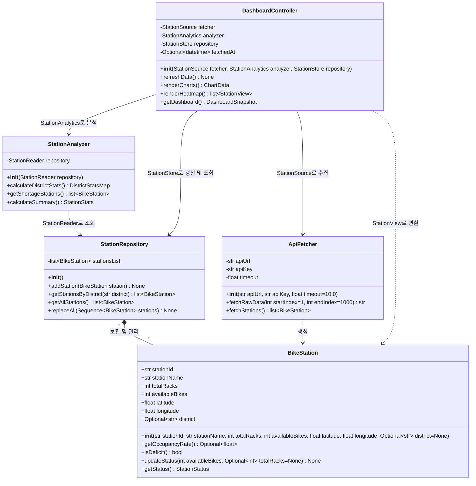

# Seoul Cycle

서울 공공자전거의 거치율, 자치구별 현황, 부족 대여소를 보여 주는 객체지향프로그래밍 팀 프로젝트

## How to run
### requirements
- Python **3.12 이상**
- Node.js **22.12 이상**
- npm

### 최초 설치

```powershell
python -m venv .venv
.\.venv\Scripts\python.exe -m pip install -r backend/requirements.lock -e "./backend[dev]"
npm.cmd --prefix frontend ci
Copy-Item .env.example .env
```

실제 서울시 API 인증키는 `.env`의 `SEOUL_API_KEY`에 or 시스템 환경 변수
참고: 키가 비어 있어도 안내 화면, 서버 상태 확인 가능

### 백엔드: 터미널 1

```powershell
.\.venv\Scripts\python.exe -m uvicorn seoul_cycle.main:app --host 127.0.0.1 --port 8000 --reload
```

- [서버 상태](http://127.0.0.1:8000/api/health): `{"status":"ok"}`
- [HTTP 계약 문서](http://127.0.0.1:8000/docs)

### 프론트엔드: 터미널 2

```powershell
npm.cmd --prefix frontend run dev
```

- [프론트엔드](http://127.0.0.1:5173)


## 사용 데이터 (Data Used)

| 데이터 | 활용 계획 |
|---|---|
| [서울시 공공자전거 따릉이 실시간 대여정보](https://data.seoul.go.kr/dataList/OA-15493/A/1/datasetView.do) | `bikeList`: 대여소 ID·이름, 거치대 수, 대여 가능한 자전거 수, 좌표를 수집하여 거치율과 상태 계산 |
| [서울시 공공자전거 따릉이 대여소 정보](https://data.seoul.go.kr/dataList/OA-13252/F/1/datasetView.do) | `tbCycleStationInfo`: 실시간 데이터에 없는 자치구 정보를 보완하여 자치구별 통계와 필터에 활용 |

- 출처: 서울특별시 서울 열린데이터광장
- 결합 기준: 실시간 데이터의 `stationId`와 대여소 정보의 `RENT_ID`
- `STA_LOC`을 `district`로 사용, 일치하는 대여소 정보가 없으면 `None`
- 실제 수집과 결합 로직은 `ApiFetcher`에서 구현 예정

## 대시보드 기능 (Dashboard Features)

### 현재 상태
- 공통 Protocol·DTO, 주요 클래스 인터페이스, HTTP 명세 준비
- FastAPI 서버 상태 확인, React 연결 안내 화면과 연결 재확인 기능
- 실제 데이터 수집·저장·분석, 대시보드 응답 조립, 지도·차트는 TODO

### 구현 계획

| 화면 / 기능 | 내용 |
|---|---|
| 요약 카드 | 전체 대여소·자전거 수, 평균 거치율, 상태별 대여소 수 |
| 자치구별 현황 | 25개 자치구 통계를 막대 차트와 지도로 표시, 자치구별 조회 |
| 부족 대여소 | 부족 대여소 목록과 상태 표, 대여소 이름 검색, 지도 핀에서 상세 정보 확인 |
| 거치율 히트맵 | 대여소 좌표와 거치율로 공간 분포 표시 |
| 데이터 갱신 | 전체 데이터를 다시 수집하여 화면 갱신, 실패 시 기존 화면 데이터 유지 |

- 검색·상태 필터는 지도와 표에 적용, 서버가 계산한 통계는 재계산하지 않음
- `DashboardController`가 응답 데이터를 조립하고 React가 화면을 표시


## 구조 및 역할

```text
backend/
  pyproject.toml, requirements.lock
  src/seoul_cycle/
    contracts/      # 공동: Protocol, DTO, 상태/자치구 상수, 예외
    fetching/       # 영역 1: ApiFetcher
    domain/         # 영역 2: BikeStation
    storage/        # 영역 2: StationRepository
    analysis/       # 영역 3: StationAnalyzer
    presentation/   # 영역 4: DashboardController, HTTP 어댑터
    bootstrap.py    # 공동: 요청마다 객체를 조립하는 유일한 지점
    settings.py     # 공동: 백엔드 환경 설정
    main.py         # 공동: FastAPI 진입점과 오류 어댑터
    export_openapi.py
frontend/
  src/api/          # HTTP 클라이언트, 자동 생성 타입
  src/features/dashboard/  # 영역 4: 화면 구현 시작점
  src/styles/       # 영역 4: 스타일
contracts/openapi.json     # 자동 생성 HTTP 명세
```

| 작업 영역 | 책임 | 시작 파일 |
|---|---|---|
| API 수집 | 전체 페이지, 보조 데이터 결합, 문자열 정규화 | [ApiFetcher](backend/src/seoul_cycle/fetching/api_fetcher.py) |
| 모델·저장소 | 거치율/상태 규칙, 객체 소유, 조회/전체 교체 | [BikeStation](backend/src/seoul_cycle/domain/bike_station.py), [StationRepository](backend/src/seoul_cycle/storage/station_repository.py) |
| 분석 | 전체/25개 구 통계, 부족 대여소 정렬 | [StationAnalyzer](backend/src/seoul_cycle/analysis/station_analyzer.py) |
| UI·시각화 | 흐름 조정, 응답 조립, React 화면과 지도/차트 | [DashboardController](backend/src/seoul_cycle/presentation/dashboard_controller.py), [DashboardPage](frontend/src/features/dashboard/DashboardPage.tsx) |


## 클래스 다이어그램



