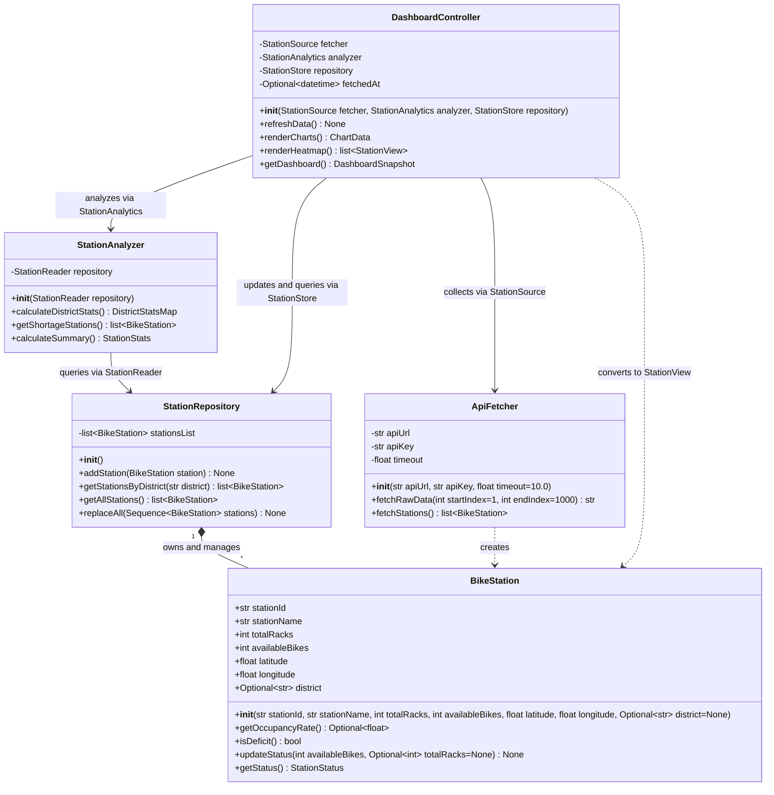

# Seoul Cycle

An object-oriented programming team project for monitoring Seoul public bicycle occupancy rates, district summaries, and stations with bike shortages

## How to Run
### Requirements
- Python **3.12 or later**
- Node.js **22.12 or later**
- npm

### Initial Setup

```powershell
python -m venv .venv
.\.venv\Scripts\python.exe -m pip install -r backend/requirements.lock -e "./backend[dev]"
npm.cmd --prefix frontend ci
Copy-Item .env.example .env
```

Set your Seoul Open Data API key as `SEOUL_API_KEY` in `.env` or as a system environment variable
The server health check and the development preview below are available without an API key

### Backend: Terminal 1

```powershell
.\.venv\Scripts\python.exe -m uvicorn seoul_cycle.main:app --host 127.0.0.1 --port 8000 --reload
```

- [Server health](http://127.0.0.1:8000/api/health): `{"status":"ok"}`
- [HTTP API documentation](http://127.0.0.1:8000/docs)

### Frontend: Terminal 2

```powershell
npm.cmd --prefix frontend run dev
```

- [Frontend](http://127.0.0.1:5173)
- [Development preview](http://127.0.0.1:5173/?mock): sample data; excluded from production builds


## Data Used

| Dataset | Planned Use |
|---|---|
| [Seoul Public Bicycle (Ttareungi) Real-Time Rental Information](https://data.seoul.go.kr/dataList/OA-15493/A/1/datasetView.do) | `bikeList`: Collect station IDs, names, rack counts, available bike counts, and coordinates to calculate occupancy rates and station statuses |
| [Seoul Public Bicycle (Ttareungi) Station Information](https://data.seoul.go.kr/dataList/OA-13252/F/1/datasetView.do) | `tbCycleStationInfo`: Add district information missing from the live data for district-level statistics and filtering |

- Source: Seoul Metropolitan Government, Seoul Open Data Plaza
- Join key: `stationId` in the live data matches `RENT_ID` in the station metadata
- Use `STA_LOC` as `district`; use `None` when no matching station metadata is found
- `ApiFetcher` collects and joins both datasets, normalizes numeric strings, and returns `BikeStation` objects
- Each request fetches at most 1,000 rows. `bikeList.list_total_count` describes the current page, so collection continues until a short or empty final page. Station metadata uses its total count to fetch all pages
- Missing joins or blank district values remain `None`. Invalid rows, duplicate IDs, incomplete metadata pages, and request failures raise `DataSourceError`; partial results are never returned
- A real API key is required for full collection. The public `sample` key is limited to five rows

## Dashboard Features

### Current Status
- Shared Protocols and DTOs, core class interfaces, and the HTTP specification are in place
- FastAPI health check and dashboard response assembly through `DashboardController`
- API collection and district joins, model validation and status rules, and repository queries and full replacement
- React summary cards, station-status bar, and refresh with previous data retained on failure
- Analysis, district charts, maps, shortage table, and filters remain TODO
- The normal dashboard returns `501` after successful collection until `StationAnalyzer` is implemented. Missing keys or collection failures return `502`

### Planned Features

| View / Feature | Description |
|---|---|
| Summary cards | Total station and bike counts, average occupancy rate, and station counts by status |
| District overview | Bar charts and maps for all 25 districts, with district-level filtering |
| Shortage stations | Shortage list and status table, station-name search, and station details through map pins |
| Occupancy heatmap | Spatial distribution of occupancy rates using station coordinates |
| Data refresh | Fetch the full dataset and update the dashboard; retain the previous data if the refresh fails |

- Search and status filters apply to maps and tables without recalculating server-provided statistics
- `DashboardController` assembles response data; React renders the UI


## Structure and Responsibilities

```text
backend/
  pyproject.toml, requirements.lock
  src/seoul_cycle/
    contracts/      # Shared: Protocols, DTOs, status/district constants, exceptions
    fetching/       # Area 1: ApiFetcher
    domain/         # Area 2: BikeStation
    storage/        # Area 2: StationRepository
    analysis/       # Area 3: StationAnalyzer
    presentation/   # Area 4: DashboardController, HTTP adapter
    bootstrap.py    # Shared: the sole object composition point, invoked per request
    settings.py     # Shared: backend configuration
    main.py         # Shared: FastAPI entry point and error adapter
    export_openapi.py
frontend/
  src/api/          # HTTP client, generated types
  src/features/dashboard/  # Area 4: UI implementation entry point
  src/styles/       # Area 4: styles
contracts/openapi.json     # Generated HTTP specification
```

| Work Area | Responsibilities | Starting Files |
|---|---|---|
| API collection | All pages, metadata joins, string normalization | [ApiFetcher](backend/src/seoul_cycle/fetching/api_fetcher.py) |
| Model and repository | Occupancy/status rules, object ownership, queries and full replacement | [BikeStation](backend/src/seoul_cycle/domain/bike_station.py), [StationRepository](backend/src/seoul_cycle/storage/station_repository.py) |
| Analysis | Overall and 25-district statistics, shortage station sorting | [StationAnalyzer](backend/src/seoul_cycle/analysis/station_analyzer.py) |
| UI and visualization | Flow coordination, response assembly, React UI, maps and charts | [DashboardController](backend/src/seoul_cycle/presentation/dashboard_controller.py), [DashboardPage](frontend/src/features/dashboard/DashboardPage.tsx) |


## Class Diagram



