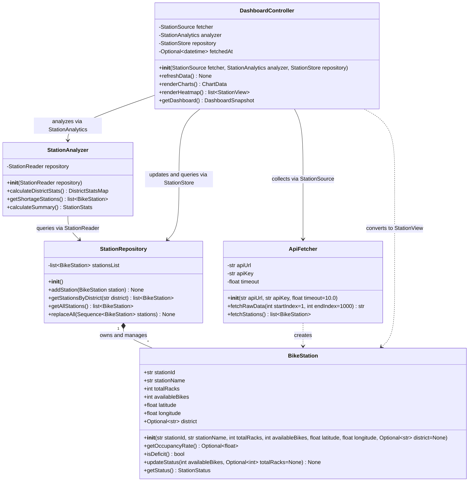

# Seoul Cycle

An object-oriented programming team project for tracking occupancy rates at Seoul's public bicycle stations, summarizing data by district, and finding stations that are short on bikes.

## How to run
### Requirements
- Python **3.12 or later**
- Node.js **22.12 or later**
- npm

### Initial setup

```powershell
python -m venv .venv
.\.venv\Scripts\python.exe -m pip install -r backend/requirements.lock -e "./backend[dev]"
npm.cmd --prefix frontend ci
Copy-Item .env.example .env
```

Set `SEOUL_API_KEY` to your Seoul Open Data API key in `.env` or as a system environment variable. You can use the server health check and development preview without a key.

### Backend: terminal 1

```powershell
.\.venv\Scripts\python.exe -m uvicorn seoul_cycle.main:app --host 127.0.0.1 --port 8000 --reload
```

- [Server health](http://127.0.0.1:8000/api/health): `{"status":"ok"}`
- [HTTP API documentation](http://127.0.0.1:8000/docs)

### Frontend: terminal 2

```powershell
npm.cmd --prefix frontend run dev
```

- [Frontend](http://127.0.0.1:5173)
- [Development preview](http://127.0.0.1:5173/?mock): uses sample data and is excluded from production builds

## Data used

| Dataset | Planned use |
|---|---|
| [Seoul Public Bicycle (Ttareungi) Real-Time Rental Information](https://data.seoul.go.kr/dataList/OA-15493/A/1/datasetView.do) | `bikeList`: Collect station IDs, names, rack counts, available bike counts, and coordinates to calculate occupancy rates and determine station statuses |
| [Seoul Public Bicycle (Ttareungi) Station Information](https://data.seoul.go.kr/dataList/OA-13252/F/1/datasetView.do) | `tbCycleStationInfo`: Add district information missing from the live data for district statistics and filtering |

- Source: Seoul Metropolitan Government, Seoul Open Data Plaza
- Match `stationId` in the live data to `RENT_ID` in the station metadata.
- Use `STA_LOC` as `district`, or `None` if no station metadata matches.
- `ApiFetcher` fetches both datasets and joins them. It normalizes numeric strings and returns `BikeStation` objects.
- Each request fetches at most 1,000 rows. Since `bikeList.list_total_count` describes only the current page, collection continues until a page is short or empty. For station metadata, the total count determines how many pages to fetch.
- Missing joins and blank district values remain `None`. Invalid rows, duplicate IDs, incomplete metadata pages, or failed requests raise `DataSourceError`. Collection never returns partial results.
- You need a real API key to collect the full dataset. The public `sample` key is limited to five rows.

## Dashboard features

### Current status
- Shared Protocols and DTOs, core class interfaces, and the HTTP specification are in place.
- FastAPI provides the health check, and `DashboardController` assembles dashboard responses.
- API collection, district joins, model validation, status rules, repository queries, full replacement, and overall/district statistics with the sorted shortage list (`StationAnalyzer`) are implemented.
- React displays summary cards and a station-status bar. A failed refresh leaves the previous data in place.
- District charts, maps, the shortage table, and filters are still TODO.
- After a successful collection, the dashboard returns the full snapshot. Missing keys and collection failures return `502`.

### Planned features

| View / feature | Description |
|---|---|
| Summary cards | Total station and bike counts, average occupancy rate, and station counts by status |
| District overview | Bar charts and maps for all 25 districts, with district-level filtering |
| Shortage stations | Shortage list and status table, station-name search, and station details through map pins |
| Occupancy heatmap | Map occupancy rates using station coordinates |
| Data refresh | Fetch the full dataset and update the dashboard, keeping the previous data if the refresh fails |

- Search and status filters affect maps and tables without recalculating the statistics supplied by the server.
- `DashboardController` assembles response data, and React renders the UI.

## Structure and responsibilities

```text
backend/
  pyproject.toml, requirements.lock
  src/seoul_cycle/
    contracts/      # Shared: Protocols, DTOs, status/district constants, exceptions
    fetching/       # Area 1: ApiFetcher
    domain/         # Area 2: BikeStation
    storage/        # Area 2: StationRepository
    analysis/       # Area 3: StationAnalyzer
    presentation/   # Area 4: DashboardController, HTTP adapter
    bootstrap.py    # Shared: the sole object composition point, invoked per request
    settings.py     # Shared: backend configuration
    main.py         # Shared: FastAPI entry point and error adapter
    export_openapi.py
frontend/
  src/api/          # HTTP client, generated types
  src/features/dashboard/  # Area 4: UI implementation entry point
  src/styles/       # Area 4: styles
contracts/openapi.json     # Generated HTTP specification
```

| Work area | Responsibilities | Starting files |
|---|---|---|
| API collection | Fetch all pages, join station metadata, and normalize strings | [ApiFetcher](backend/src/seoul_cycle/fetching/api_fetcher.py) |
| Model and repository | Define occupancy and status rules, manage object ownership, query stations, and replace all stored data | [BikeStation](backend/src/seoul_cycle/domain/bike_station.py), [StationRepository](backend/src/seoul_cycle/storage/station_repository.py) |
| Analysis | Calculate statistics overall and for all 25 districts, and sort shortage stations | [StationAnalyzer](backend/src/seoul_cycle/analysis/station_analyzer.py) |
| UI and visualization | Coordinate data flow, assemble responses, and build the React UI, maps, and charts | [DashboardController](backend/src/seoul_cycle/presentation/dashboard_controller.py), [DashboardPage](frontend/src/features/dashboard/DashboardPage.tsx) |

## Class diagram



